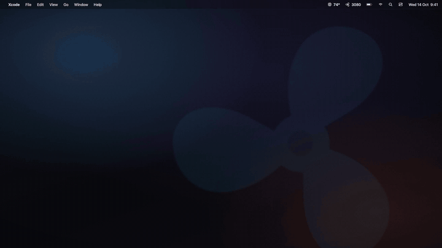
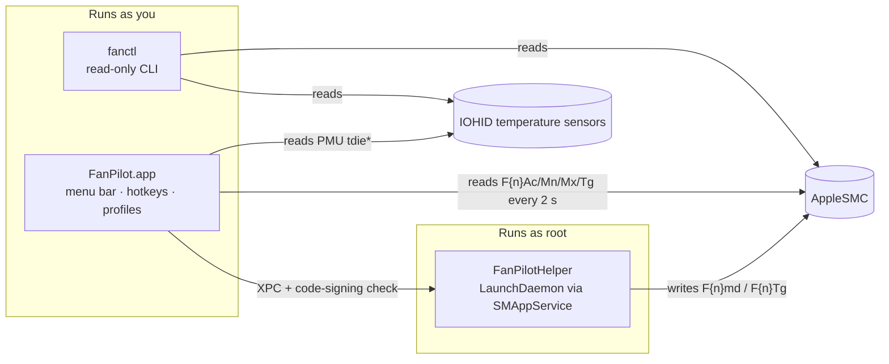

<div align="center">


### Fan control for Apple Silicon. On your keyboard.

`fn F5` faster · `fn F4` slower · `fn ⇧F4` back to Automatic · `fn ⇧F5` next profile

[](https://github.com/notvasub/fanpilot/actions/workflows/ci.yml)


[](LICENSE)

<br>



</div>

---

FanPilot is an open-source menu-bar fan controller for Apple Silicon Macs. It puts fan speed on two keys, shows a HUD like the system volume HUD on every press, and lets you switch between profiles that run each fan on Automatic, a fixed speed, or a temperature curve.

It is modeled on how [Macs Fan Control](https://crystalidea.com/macs-fan-control) works (see the [teardown](docs/macs-fan-control-teardown.md)). It is not affiliated with it.

## Contents

- [Features](#features)
- [Requirements](#requirements)
- [Install](#install)
- [First run](#first-run)
- [Using FanPilot](#using-fanpilot)
- [Profiles](#profiles)
- [Safety](#safety)
- [How it works](#how-it-works)
- [`fanctl` diagnostics](#fanctl-diagnostics)
- [Uninstall](#uninstall)
- [Troubleshooting](#troubleshooting)
- [Project layout](#project-layout)
- [Contributing](#contributing)
- [License](#license)

## Features

| | |
|---|---|
| ⌨️ **Keyboard first** | `fn F5` / `fn F4` move the fans up or down one step (10% by default, configurable 5–25%). No Accessibility or Input Monitoring permission: hotkeys use Carbon `RegisterEventHotKey`. |
| 🎛️ **Profiles** | Automatic, Quiet, Balanced, Performance and Full Speed built in. Add as many of your own as you like, with separate settings per fan if you want them. |
| 📈 **Temperature curves** | Ramp linearly from a start temperature to a full-speed temperature, driven by CPU average or CPU hottest. Changes are smoothed so the fans don't hunt. |
| 🖥️ **Menu-bar panel** | CPU °C (average and max), live RPM per fan, Manual/Auto badges, a manual speed slider and "Save as Profile…". |
| 🔒 **Least privilege** | The only root code is a small helper that writes fan keys, behind XPC with a code-signing check on both ends. |
| 🛟 **Hands the fans back** | Quit, sleep, a crash, or Macs Fan Control starting: the fans return to the Mac's own thermal management. |
| 🔬 **Inspectable** | Read-only `fanctl` CLI prints the raw SMC keys and every temperature sensor. |

## Requirements

- An Apple Silicon Mac **with fans** (MacBook Pro, Mac mini, Mac Studio, Mac Pro, iMac with fans). The fanless MacBook Air has nothing to control.
- macOS 14 Sonoma or later.
- Xcode 16 or later (Swift 6 toolchain) to build. The Command Line Tools alone are enough for `swift build`, but a full Xcode install gives you an Apple Development signing identity.

FanPilot is distributed as source. There are no prebuilt binaries: you build and sign it on your own Mac, so the root helper only ever trusts code you built.

## Install

### 🤖 Insert this prompt into your agent

Paste this into Claude Code, Codex, Cursor or any coding agent that can run terminal commands. It does every step below for you and only stops for the one thing that needs you: approving the helper in System Settings.

```text
Install FanPilot (https://github.com/notvasub/fanpilot), an open-source menu-bar fan
controller for Apple Silicon Macs, on this Mac. Run each step in the terminal, check its
output, and stop to tell me if anything fails. Do not use sudo.

1. Preflight checks. Stop and explain if any fail:
   - `uname -m` must print `arm64` (Apple Silicon).
   - `sw_vers -productVersion` must be 14.0 or later.
   - `sysctl -n hw.model` must not be a MacBook Air (fanless; nothing to control).
   - `swift --version` must work and report Swift 6 or later. If it doesn't, tell me to
     install Xcode 16+ from the App Store, open it once, then rerun this prompt.

2. Clone the repo into ~/fanpilot (if that folder already exists and is this repo,
   `git pull` instead):
   git clone https://github.com/notvasub/fanpilot.git ~/fanpilot
   cd ~/fanpilot

3. Run the tests: `swift test`. All tests must pass before continuing.

4. Check for a code-signing identity: `security find-identity -v -p codesigning`.
   - If an "Apple Development" or "Developer ID Application" identity is listed, continue.
   - If none is listed, tell me that the build will be ad-hoc signed (works, but the
     helper must be reinstalled after every rebuild) and that I can get a free identity
     in Xcode → Settings → Accounts → Manage Certificates → + → Apple Development.
     Then continue with ad-hoc signing.

5. Build, sign and install the app to /Applications:
   scripts/build-app.sh --install
   Confirm the output ends with "Installed /Applications/FanPilot.app".

6. If Macs Fan Control is running (`pgrep -x "Macs Fan Control"`), tell me to quit it.
   FanPilot pauses fan control while it runs.

7. Register the root helper:
   /Applications/FanPilot.app/Contents/MacOS/FanPilot --install-helper
   This opens System Settings → General → Login Items. Tell me to turn on "FanPilot"
   under "Allow in the Background" (it asks for my admin password), and wait for me to
   say I've done it.

8. Verify: /Applications/FanPilot.app/Contents/MacOS/FanPilot --helper-status
   must print "helper: enabled". If it says "requires approval", repeat step 7's
   instructions.

9. Launch the app: open /Applications/FanPilot.app

10. Finish by telling me:
    - A fan icon is now in the menu bar; click it for temperatures, RPM and profiles.
    - fn F5 = faster, fn F4 = slower, fn ⇧F4 = back to Automatic, fn ⇧F5 = next profile.
    - To uninstall: /Applications/FanPilot.app/Contents/MacOS/FanPilot --uninstall-helper
      then rm -rf /Applications/FanPilot.app
```

### Manual install

**1. Clone and test**

```bash
git clone https://github.com/notvasub/fanpilot.git
```

```bash
cd fanpilot && swift test
```

**2. (Recommended) Have a signing identity**

The build script signs with, in order:

1. `$FANPILOT_SIGN_IDENTITY`, if set
2. your first **Apple Development** or **Developer ID Application** identity in the keychain
3. ad-hoc signing (`-`) as a fallback

Any free Apple ID gives you an Apple Development identity: open Xcode → Settings → Accounts, add your Apple ID, then **Manage Certificates… → + → Apple Development**. Check it is there:

```bash
security find-identity -v -p codesigning
```

With a team identity, the app and helper trust any build signed by your team. With ad-hoc signing they still work, but the helper only trusts that exact build, so re-register the helper after each rebuild (see [Troubleshooting](#troubleshooting)).

To pick a specific identity:

```bash
export FANPILOT_SIGN_IDENTITY="Apple Development: you@example.com (TEAMID1234)"
```

**3. Build and install to /Applications**

```bash
scripts/build-app.sh --install
```

This builds `FanPilot` and `FanPilotHelper` in release mode, assembles `build/FanPilot.app` with the helper's LaunchDaemon plist embedded, signs both with the hardened runtime, verifies the signature, and copies the app to `/Applications`. The helper is registered from that path, so install there before turning it on.

Run `scripts/build-app.sh` without `--install` to only build into `build/FanPilot.app`.

## First run

1. **Quit Macs Fan Control** if you use it. Its helper can stay installed; FanPilot pauses itself while Macs Fan Control is running so the two never fight.
2. Open **/Applications/FanPilot.app**. A fan icon appears in the menu bar.
3. Click it, then **Install Helper…**.
4. macOS opens **System Settings → General → Login Items** (you can also do this step from a terminal with `/Applications/FanPilot.app/Contents/MacOS/FanPilot --install-helper`). Under **Allow in the Background**, turn on **FanPilot**. This asks for an admin password.
5. Press `fn F5` a few times. The HUD shows the new manual speed (for example `Manual 50%  ≈ 5,072 RPM`) and the fans spin up. Press `fn ⇧F4` to hand them back to Automatic.

Optional: turn on **Launch at Login** from the status menu at the bottom of the panel.

## Using FanPilot

### Keyboard

| Keys | Action |
|---|---|
| `fn F5` | Faster, one step |
| `fn F4` | Slower, one step |
| `fn ⇧F4` | Back to Automatic |
| `fn ⇧F5` | Next profile |

Steps snap to multiples of the step size, so from 47% one press goes to 50%. Change the step under the status menu → **Hotkey Step** (5, 10, 15, 20 or 25%).

The top row defaults to media keys, so bare F4 and F5 still do Spotlight and Dictation. Only `fn` plus the key reaches FanPilot. If you have set "Use F1, F2, etc. keys as standard function keys", it is the other way round.

### Menu-bar panel

- The menu-bar label shows the average RPM, with an outline fan in Automatic and a filled fan otherwise.
- The panel shows CPU temperature (average · max), one row per fan with its RPM, range and target, the profile list, and a **Manual speed** slider with − / + and **Save as Profile…**.
- **Profiles…** opens the profile editor.

## Profiles

| Profile | What it does |
|---|---|
| **Automatic** | The Mac's own thermal management. In Automatic, fans on recent Macs stop completely at idle. |
| **Quiet** | Curve on CPU average, 60 °C → 90 °C |
| **Balanced** | Curve on CPU average, 50 °C → 80 °C |
| **Performance** | Curve on CPU hottest, 45 °C → 75 °C |
| **Full Speed** | Fixed 100% |

In the **Profiles** window, click **+** (or **Duplicate** a built-in) to make your own. Each profile has a mode, **Automatic**, **Fixed speed** or **Follow temperature**, and you can tick **Separate settings per fan**. Curves take a sensor (CPU average or CPU hottest), a **Start ramping at** temperature and a **Full speed at** temperature.

Curve targets are smoothed: up to +800 RPM per 2-second tick, down 200 RPM per tick, and changes under 100 RPM are ignored. If no temperature is available, a curve falls back to Automatic. Percentages map onto each fan's own min–max range, and nothing goes below the SMC minimum.

## Safety

FanPilot is built so that every failure returns the fans to the Mac:

- Fans go back to **Automatic** when you quit, before the Mac sleeps, and when the helper loses its last client (for example if the app crashes).
- Fan control **pauses while Macs Fan Control is running**.
- The helper **clamps every target** to the fan's own minimum and maximum RPM. Manual targets never go below the SMC minimum.
- The helper accepts XPC connections only from code that matches FanPilot's code-signing requirement, and the app only talks to a helper that matches its own.

> [!WARNING]
> FanPilot writes to the System Management Controller through undocumented interfaces. It cannot make fans run slower than the Mac's own minimum, but you use it at your own risk. If anything looks wrong, press `fn ⇧F4` or quit the app and the Mac takes over again.

## How it works



| Piece | Runs as | Does |
|---|---|---|
| `FanPilot.app` | you | Menu-bar UI, hotkeys, profiles. Reads fan RPMs from the SMC (`F{n}Ac/Mn/Mx/Tg/md`) and CPU die temperatures from the IOHID sensors (`PMU tdie*`) every 2 s, and decides each fan's target. |
| `FanPilotHelper` | root (LaunchDaemon via `SMAppService`) | Only fan writes: the mode key (`F{n}md` / `F{n}Md` / `FS! `), `Ftst` where it exists, and `F{n}Tg`, with targets clamped to the fan's own min/max. |
| `fanctl` | you | Read-only diagnostics. |

The app decides; the helper only writes. The reference machine is a Mac17,9 (M5 Pro): 2 fans, 2,317–7,826 RPM, controlled through `F{n}md` (0 = automatic, 1 = manual), no `Ftst` key.

## `fanctl` diagnostics

Build it with `swift build -c release --product fanctl`, then run `.build/release/fanctl`. It never writes.

| Command | Prints |
|---|---|
| `fanctl` | Fan count, mode style, and every fan key with its type and raw bytes |
| `fanctl temps` | Every IOHID temperature sensor |
| `fanctl keys F` | All SMC keys starting with `F` |
| `fanctl read F0Tg` | One key |

```text
$ fanctl
fans: 2  modeStyle: perFanLowercase  Ftst: absent
fan 0:
  F0Ac: type='flt ' size=4 value=7817.0 [0048f445]
  F0Mn: type='flt ' size=4 value=2317.0 [00d01045]
  F0Mx: type='flt ' size=4 value=7826.0 [0090f445]
  F0Tg: type='flt ' size=4 value=7826.0 [0090f445]
  F0md: type='ui8 ' size=1 value=1.0 [01]
```

If you open an issue about an unsupported Mac, please include the output of `fanctl` and your model identifier (`sysctl hw.model`).

## Uninstall

Open the status menu at the bottom of the panel and choose **Uninstall Helper**, then quit. Or from a terminal:

```bash
/Applications/FanPilot.app/Contents/MacOS/FanPilot --uninstall-helper
```

```bash
rm -rf /Applications/FanPilot.app
```

Custom profiles and settings live in FanPilot's user defaults. For a clean removal:

```bash
defaults delete com.vasu.fanpilot
```

## Troubleshooting

**Check the helper's state**

```bash
/Applications/FanPilot.app/Contents/MacOS/FanPilot --helper-status
```

**"Requires approval"**: turn on FanPilot in System Settings → General → Login Items → Allow in the Background.

**Fans don't respond after a rebuild** (most often with ad-hoc signing, where the helper pins the exact build): uninstall the helper, rebuild and install, then install the helper again.

```bash
/Applications/FanPilot.app/Contents/MacOS/FanPilot --uninstall-helper
```

```bash
scripts/build-app.sh --install
```

**Hotkeys do nothing**: make sure you are holding `fn`. Another app may also have registered the same combination.

**Panel says "Macs Fan Control is running"**: FanPilot pauses while it runs. Quit it (the panel has a **Quit Macs Fan Control** button).

**No temperatures**: curves fall back to Automatic. Run `fanctl temps` and include the output in an issue.

## Project layout

```text
Sources/CSMC            C: AppleSMC user-client calls (80-byte SMCKeyData_t) + private IOHID temperature API
Sources/FanCore         Models, profile JSON, curve/ramp math, SMC value codec, XPC protocol, code-signing requirements
Sources/SMCKit          Swift SMC connection, fan-level reads/writes, temperature summary
Sources/FanPilotHelper  Root daemon: XPC listener + serialized FanWriter + disconnect watchdog
Sources/FanPilot        SwiftUI MenuBarExtra app, profiles window, hotkeys, HUD, SMAppService management
Sources/fanctl          Read-only CLI
Support/                App Info.plist and the helper's launchd plist (BundleProgram)
Tests/FanCoreTests      Control logic, profile coding, SMC value codec
scripts/build-app.sh    Build, assemble, sign, install
website/                Project site (Astro)
launch-video/           Launch film, rendered in code with Remotion (see its README)
docs/                   Macs Fan Control teardown, README media
```

## Contributing

Issues and pull requests are welcome. Before opening a PR:

```bash
swift test
```

Fan behavior differs between Mac models, so reports from machines other than the M5 Pro reference are especially useful. Include `fanctl` output and `sysctl hw.model`.

The website lives in `website/` (`npm install && npm run dev`), and the launch film in `launch-video/`.

## License

[MIT](LICENSE) © 2026 Vasu Bansal

Not affiliated with Apple or CrystalIDEA. Macs Fan Control is a trademark of its owner.
